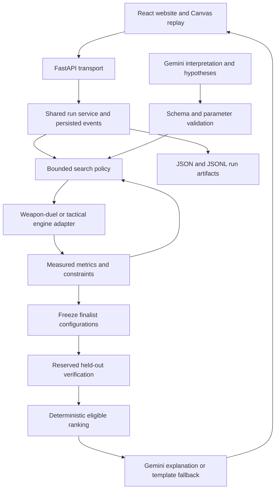

# RAGENT Full Implementation Plan

Revised November 14, 2026, after pulling remote main through `66c710f` into the existing main checkout (`7dbcce5`). This is the complete target; [DEMO_PLAN.md](DEMO_PLAN.md) is the smaller delivery path. Planning only: the features below are not implemented by this document.

## 1. Outcome and relationship to the demo plan

Build the workbench in [VISION.md](VISION.md): developers submit weapon and ability changes, test individual changes and combinations, explore bounded alternatives, and receive a ranked shortlist with independent verification, explanations, and reproducible visual evidence.

Deliver the minimal demo first. Its Gemini adapter, content snapshots, candidate identities, saved runs and replay format become the foundation of this plan. Then migrate application boundaries and add capabilities incrementally. Preserve the working website and existing tests at each checkpoint. Work in `/home/sahas_u/projects/Ragent` on its existing branch; do not create another branch or worktree unless requested.

The full target stack is React, TypeScript, Vite and Tailwind on the frontend; Python, FastAPI and Uvicorn on the backend; Pydantic schemas; Google GenAI SDK for Gemini; JSON/JSONL artifact storage; Canvas 2D for game visualization; pytest plus focused frontend tests. Pin versions when implementing. A database, 3D engine and distributed job queue are unnecessary for this scope.

## 2. Verified starting point

The latest review ran all 22 existing tests successfully, built the React bundle, generated a tactical replay, and completed an HTTP submission → polling → HTML/JSON download check. Browser appearance, Godot execution and deployed CI were not verified. OpenFire's pinned submodule is not initialized locally.

| Existing code | Keep and extend | Required changes |
| --- | --- | --- |
| `frontend/src.jsx`, `web/app.css` | React forms, progress log, comparisons, recommendations, downloads | Extract components; add real artwork, replay, history and accessible presentation; migrate incrementally to TypeScript/Vite/Tailwind |
| `ragent_openfire/web.py` | Request validation, run lifecycle, report assembly | Extract service logic, persist run state, then move HTTP transport to FastAPI |
| `ragent_openfire/simulation.py` | Seeded weapon duels, paired first-shooter assignments, metrics and traces | Content adapter, explicit model assumptions, trace improvements and additional evaluation coverage |
| `ragent_openfire/agent.py` | Bounds checking, candidate deduplication, heuristic fallback, seed-separated verification | Gemini provider, both exploration modes, result-driven scheduling, stronger eligibility and candidate provenance |
| `ragent_openfire/reports.py` | HTML/JSON report structure | Evidence references, grounded Gemini explanations, source metadata and complete search history |
| `simulator/`, `experiments/` | Tactical combat, abilities, objective mechanics, recorded frames, standalone Canvas replay | Separate adapter into the shared run contract; agent-specific loadouts, side swaps and validation |
| Weapon exporter, Godot bridge and CI | Existing OpenFire integration | Keep as an optional engine profile; do not require native Godot to run the web demo |

There are two simulation engines, not one unified gameplay implementation. OpenFire weapon duels drive the React dashboard; tactical simulation supplies the separate map replay. Their metrics and traces must retain an engine ID. Never use one engine's replay as evidence for another engine's result.

The dashboard currently forces `allow_llm=False`; the optional provider elsewhere calls OpenAI, not Gemini. Search generates its candidate pool up front rather than adapting to measured batches. Run records live in process memory; report files survive, but reopening them after a restart is not implemented. These are concrete extension points, not reasons to rewrite the simulator.

## 3. Product flow and architecture

1. Select an engine/content profile and see its source version and supported mechanics.
2. Submit structured proposals or ask Gemini to parse a text idea; confirm interpreted edits.
3. Choose **Evaluate submitted ideas** or **Explore related variants**; set bounds, target ranges, protected scenarios and budget.
4. Run baseline, individual changes and useful combinations. Show each batch's measured selection reasons, outcomes and rejected candidates.
5. Freeze finalists, evaluate them against reserved verification cases, and rank eligible candidates in code.
6. Compare baseline, developer proposal and recommendation; inspect an engine-matched replay and Gemini's evidence-linked explanation.
7. Reopen or export the run, configuration, source snapshot and reproduction details. Developers choose what goes to playtesting.

Extract the shared run service from the current handler before changing its HTTP framework. Keep current routes working until React consumes the new API. Use a bounded local worker process for CPU-heavy simulations; request handlers only submit work or read persisted state. Mark interrupted runs after restart. Add idempotent submission, explicit queue capacity, timeouts and active-run polling with event sequence cursors. Do not run simulations again on browser refresh.

Target API: catalog, create/list/read runs, events after a sequence, candidate details, report and selected replay. Define these endpoints with schemas before implementing them. Existing `/api/config`, `/api/runs` and report downloads can remain compatibility routes during migration.

## 4. Shared contracts and storage

| Record | Required contents |
| --- | --- |
| Run specification | Engine/version, original proposal, confirmed edits, exploration mode, parameter bounds, targets, rules, seed/scenario partitions, simulation/time/model budgets, content snapshot hash |
| Candidate | Canonical effective patch, stable ID, parent and idea IDs, proposal source, generation round, selection reason, validation outcome |
| Evaluation | Partition, scenario/seed blocks, raw outcomes, draw handling, metrics, uncertainty, constraint results, regressions, ranking components |
| Replay | Engine/schema version, candidate/config hash, scenario, seed, initial state, timed positions/events, final state and outcome |
| Model call | Purpose, model/settings, prompt/schema version, sanitized request/response, validation outcome, latency and usage where available |
| Audit event | Monotonic sequence, time, run/candidate IDs, decision type, reason and evidence references |
| Content snapshot | Provider, source URLs, available patch/version, retrieval time, hashes, units, mapped fields and approximations |

Write manifests, events, candidates, evaluations, verification, model calls, replay data and reports under `results/runs/<run_id>/`. Use atomic snapshot writes and append-only events. Include source revision and a dirty-source fingerprint where needed. Never record API keys. Save failed and rejected attempts as well as the winner. Reproduction loads pinned inputs and does not require a model call.

## 5. Real game inputs and engine scope

Start with the two-weapon VALORANT profile delivered by the demo plan. Expand to three weapons, three agent profiles and one supported tactical map sector only after the existing loop is integrated.

Use Riot's [Public Content Catalog](https://developer.riotgames.com/docs/valorant#assets) for published assets where available and [Valorant-API](https://valorant-api.com/) for additional portraits, weapon art, minimaps and static stats. The latter is unofficial. Validate actual fields and save selected assets/JSON locally. Record source/version/freshness; do not claim an old snapshot is the latest patch. Keep OpenFire and VALORANT profiles separately named.

Map only stats whose meaning the engine supports. Piecewise damage ranges, hit zones, armor, spread and movement need explicit modeling or visible approximation labels. Never rename an OpenFire fixture to Vandal/Spectre without changing and validating the source values. Numeric abilities absent from a catalog require documented source values and units; unsupported mechanics stay unsupported.

For the tactical engine, assign abilities to the appropriate agent rather than giving everyone smoke/dash/heal. Implement charge, duration and recharge semantics deliberately. Calibrate map coordinates and collision geometry separately from artwork. Test objectives and side swaps. Do not equate a painted minimap with accurate VALORANT geometry.

Real assets and baseline stats are inputs; generated results remain simulated. Actual match telemetry is optional context requiring separate access. Riot's public API cannot run hypothetical patches. Include source attribution and the non-endorsement notice described in Riot's [fan-content policy](https://www.riotgames.com/en/legal).

## 6. Gemini integration

Reuse the demo's `ragent_openfire/gemini_client.py` behind a shared provider interface instead of building a second adapter in `agents/`. Use the [Google GenAI SDK](https://ai.google.dev/gemini-api/docs/quickstart) and [structured outputs](https://ai.google.dev/gemini-api/docs/structured-output), with a tested model selected through configuration. `GEMINI_API_KEY` stays server-side; explicitly load local environment configuration during startup if `.env` is supported. A file's existence alone does not load its values.

Gemini has three jobs: interpret proposals, propose bounded hypotheses/interactions from discovery evidence, and explain the final evidence. Search code decides allocation; simulation computes metrics; code determines eligibility and ranking. Model calls cannot edit policies, calculate reported win rates or declare a candidate verified.

Validate finite values, allowed paths, integer fields, bounds, compatibility and duplicate patches. Confirm parsed user intent before running. Request explanations with evidence IDs; validate those references and populate numeric claims from measured facts. Keep generated interpretation visibly separate. Bound latency, retries, output length and call count; malformed responses, timeouts and quota failures fall back to deterministic candidates/templates with an explicit status. Record a genuine successful model call before declaring integration complete.

## 7. Search and independent verification

Submitted-only mode preserves submitted values and tests singles plus compatible subsets. Variant mode can tune only the confirmed allowlisted bounds. Start with at most three dimensions and three non-baseline values per dimension, plus unchanged, giving at most 63 nonempty combinations before filtering. Canonicalize relative to the original baseline and reject conflicting edits.

Extend the fixed search through successive measured batches: evaluate singles, prioritize combinations addressing observed weaknesses, reserve approximately 25% of each subsequent batch for unexplored alternatives, and allocate more discovery samples to promising or uncertain candidates. Record the evidence behind each choice. Compare with a fixed-order grid at equal total simulation budgets; add Bayesian optimization only if it measurably helps.

Freeze discovery and held-out manifests before selection, including disjoint seeds and at least one new scenario/policy variation. Search and Gemini proposal prompts see discovery results only. Freeze up to three finalists before verifying. Never use failed holdout results to keep tuning inside the same run; a new search requires a fresh holdout.

Pair baseline/candidate scenario, seed and first-side assignment. Treat each seed/scenario block, including dependent rounds and swaps, as the uncertainty unit. Show sample counts and paired intervals where adequately supported; label small samples exploratory. Seed separation alone does not establish generalization across strategies or the real game.

Rank in code: reject static/invariant failures first; exclude outcome-constraint failures and unverified candidates from the eligible shortlist; prefer improvement toward configured target ranges with acceptable protected-scenario regressions; among practically equivalent robust candidates, prefer fewer edits then smaller normalized changes. Freeze tolerances and thresholds in the run specification. Keep an ineligible best-effort candidate available for inspection without calling it an approved recommendation. Permit “no verified improvement.”

Retain existing win-rate, TTK, first-shooter and spread metrics. Add scenario target deviation and coverage rather than optimizing a single overall 50% win rate. Expose draw handling, weighting and model assumptions. Do not treat a desired shotgun/sniper range advantage as a defect. Benchmark quality against effort without claiming unmeasured human-time or retention savings.

## 8. React website and visual game experience

Keep working React components while extracting configuration, run progress, candidate comparison, explanation, replay and history views. Migrate the build to Vite and components to TypeScript, then introduce Tailwind design tokens incrementally. Preserve existing visual work and API behavior during these changes.

Visual quality is required: dark charcoal/navy, warm white text, restrained coral accents, readable cyan/amber team colors, generous spacing, real portraits and weapon silhouettes. Support demo layouts at 1440×900 and 1280×720, keyboard controls, focus states and reduced motion. Use RAGENT branding with game-asset attribution.

Build on the demo's engine-matched duel replay. For the tactical adapter, adapt existing recorded frames into the shared replay contract, then render map geometry, agent portraits, equipment, health, smoke, dash, shots, eliminations and objective state. Play/pause, scrub, speed and synchronized baseline/candidate comparison are required. Interpolation affects display only. Show divergent durations and preserve each trace's actual outcome. Keep a compact parameter diff, candidate ID, seed and verification status visible near the stage.

Report views show individual and combined effects, constraints/rejections, discovery versus verification, ranking tradeoffs, Gemini interpretation, source data, search progression, measured runtime/effort, and exports. The report must remain readable when Gemini fails or no patch is verified.

## 9. Delivery order and effort

Effort is a planning estimate, not a confirmed deadline. Budget approximately 8–12 elapsed working hours for the minimal plan with two builders, followed by another 16–28 elapsed working hours for the full target, re-estimated after content/model integration. Workstreams describe team ownership; they do not require spawning coding agents.

| Phase | Main work | Exit condition |
| --- | --- | --- |
| A: demo foundation | Complete [DEMO_PLAN.md](DEMO_PLAN.md) | Polished weapon-balance flow with Gemini, real inputs, replay and saved reports |
| B: service/contracts | Extract shared service, version schemas, persist audit/history and add FastAPI behind existing behavior | Old and new transport produce equivalent results; refresh/restart works |
| C: frontend migration | Vite, TypeScript, Tailwind and component extraction | Same user flow passes build/browser checks without a visual regression |
| D: search/verification | Both modes, adaptive batches, frozen finalists, stronger constraints and coverage | Equal-budget comparison and independent verification are reproducible |
| E: tactical coverage | Integrate tactical engine, supported agent abilities, coordinate-calibrated replay | Weapon and ability changes have matching metrics and visual evidence |
| F: final validation | Failure paths, fresh setup, walkthrough, recording and measured report | Full acceptance below passes |

Stop expanding scope if the demo checkpoint regresses. Defer extra maps, skins, telemetry, 3D rendering, advanced optimization, auth and deployment integrations. Do not delete the legacy simulator, reports or OpenFire path merely to make directories look uniform.

## 10. Acceptance and handoff

- Existing 22 tests remain green; new tests cover bounds/modes, candidate identity, static/outcome eligibility, budgets and failure handling.
- Real content mappings match saved source fields/units and visibly disclose unsupported mechanics.
- Gemini calls reach the React workflow, invalid output falls back, secrets remain private, and report claims reference measured evidence.
- Adaptive search changes future allocation from discovery outcomes; fixed-order baseline uses an equal budget.
- Verification is disjoint, frozen before evaluation and cannot feed back into search. A failed candidate cannot become an eligible recommendation.
- Each replay names its engine, seed and candidate and reproduces its measured outcome; tactical traces implement legal abilities and objectives.
- React → API → worker → artifacts → report/replay passes a browser walkthrough, including no-recommendation, model failure, refresh, restart and offline inspection.
- TypeScript/build checks, core tests, new engine tests and responsive/accessibility checks pass. Godot remains explicitly unverified until run with its required environment.

Handoff: setup commands, pinned dependencies, sanitized environment example, content/asset manifest and attribution, synthetic experiment presets, example successful and failed runs, test results, source hashes, reproduction commands, a demo recording and measured runtime/budget guidance. Nothing automatically ships a game patch.
